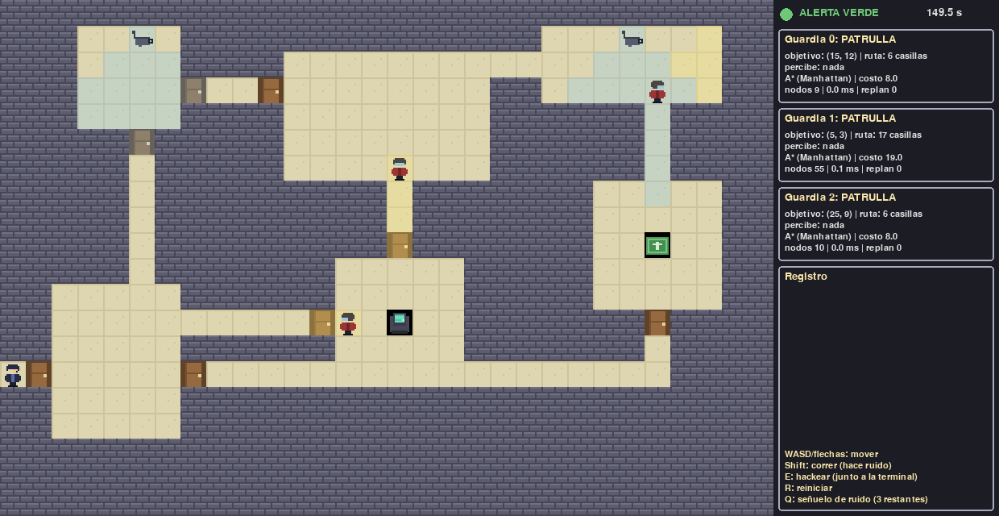
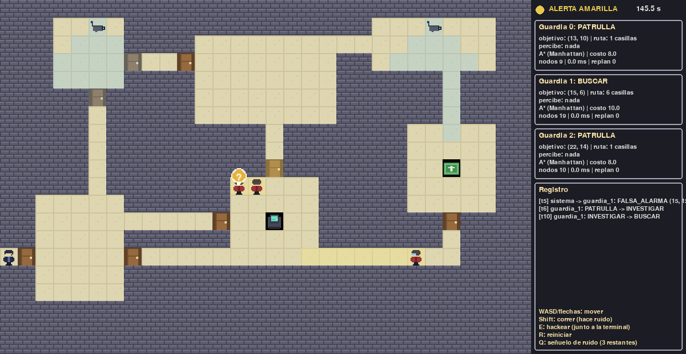
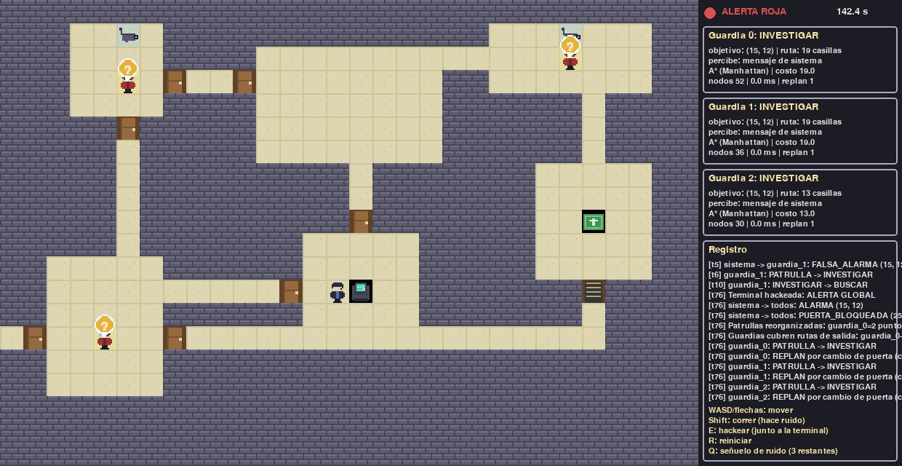
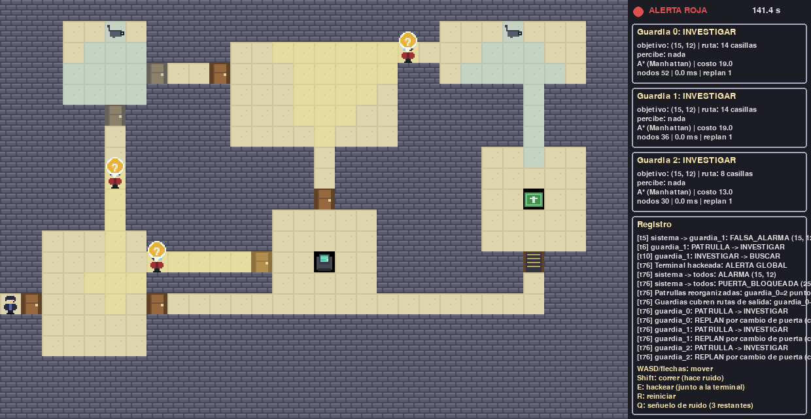
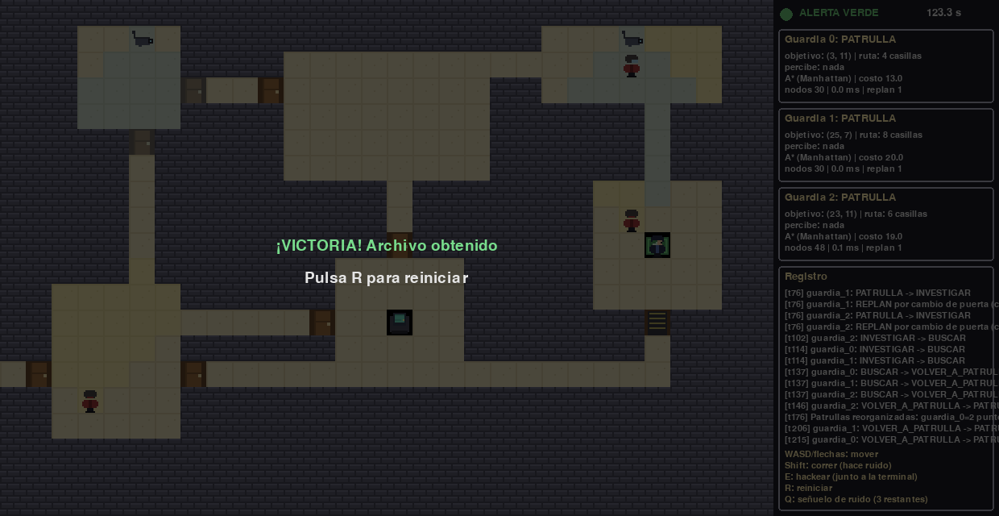
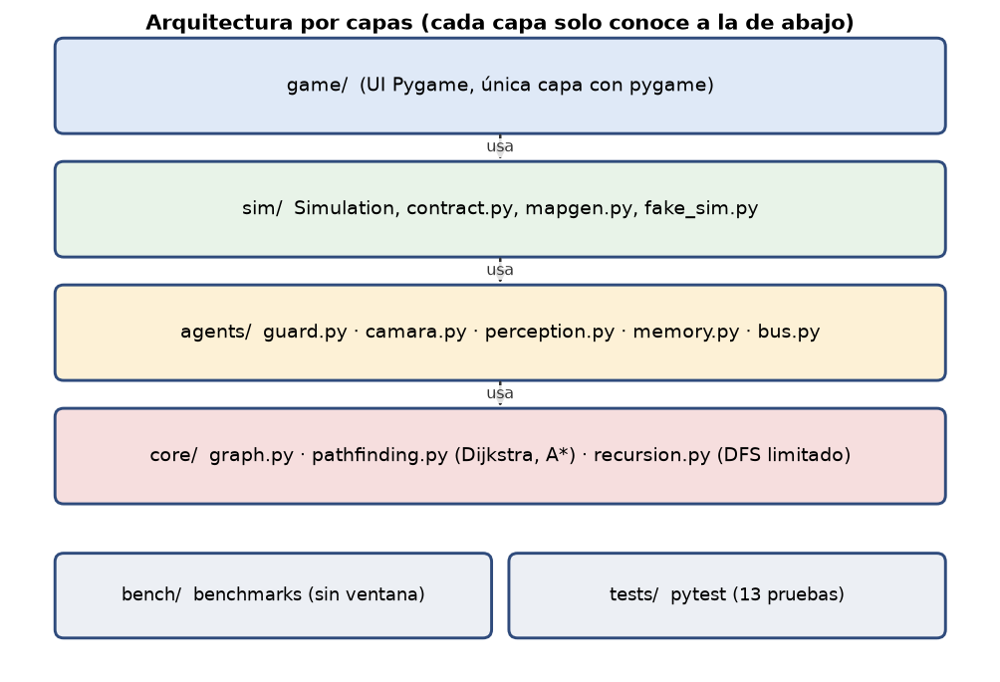
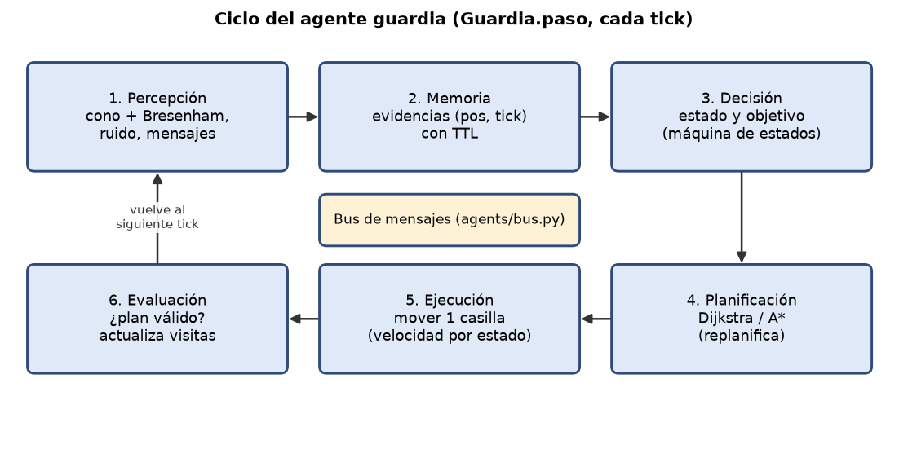
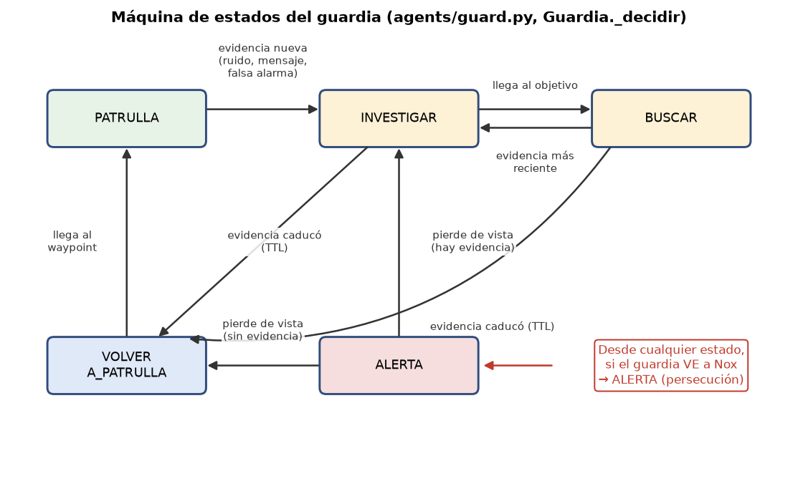
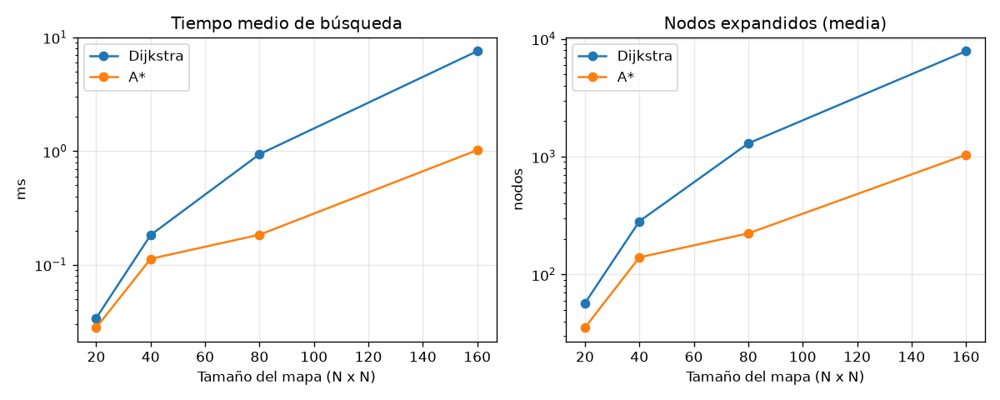
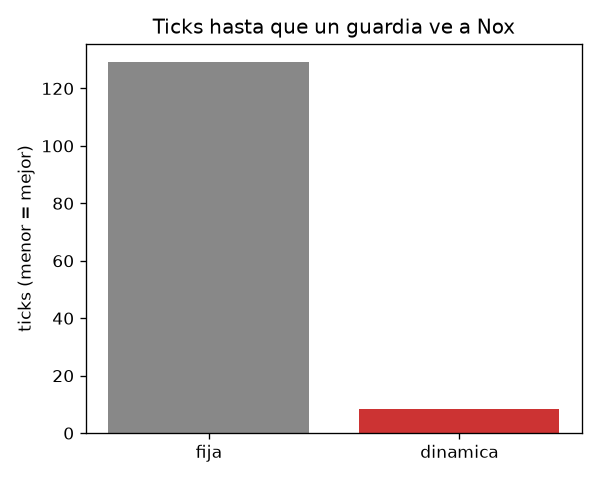

# Protocolo Sombra — Informe técnico del proyecto final

**Universidad:** Fundación Universitaria de Popayán · **Asignatura:** Algoritmos Computacionales
**Docente:** Andrés Felipe Arboleda · **Fecha:** {{FECHA}}
**Integrantes:** Sebastian Mamian Palta · Hernando Andres Peña · Keymmer Kaleth Meneses · Juan David Erazo Meneses
**Repositorio:** https://github.com/hiTimmyy/protocolo-sombra

<!--FIN-PORTADA-->

## Resumen

*Protocolo Sombra* es un videojuego 2D de vista cenital, escrito en Python y Pygame, de infiltración y vigilancia. La agente **Nox** debe entrar por el lateral de una instalación, hackear una terminal y llegar a la extracción antes de que se acabe el tiempo, sin ser capturada por guardias robóticos **autónomos** que no conocen su posición de forma permanente. Los guardias perciben (visión en cono con línea de visión y oído), recuerdan evidencias que **caducan**, se comunican por un **bus de mensajes**, deciden con una **máquina de estados** y planifican rutas con **Dijkstra** o **A\*** sobre el mismo grafo de costos no negativos. Cuando una puerta cambia de estado, replanifican y reorganizan sus patrullas.

Este informe documenta el diseño (agentes, grafo, heurística, recursión), el análisis teórico de complejidad y los resultados experimentales **reales** obtenidos con el código del repositorio ({{N_PRUEBAS}} pruebas automáticas y benchmarks reproducibles con semillas registradas). Resultados principales: (1) el costo de las rutas de A\* coincide con el de Dijkstra en todas las condiciones medidas, como predice la teoría; (2) en un mapa de 160×160, A\* expandió {{PCT_NODOS_160}} % menos nodos y fue {{VEL_160}} veces más rápido que Dijkstra; (3) en búsquedas reales de partidas simuladas, A\* expandió {{PCT_NODOS_PARTIDAS}} % menos nodos con el mismo costo; (4) la cobertura dinámica detecta antes a Nox cuando ella hace ruido ({{COB_DIN_CORR}} frente a {{COB_FIJA_CORR}} ticks de media).

## 1. Introducción y objetivos

**Problema.** Diseñar un videojuego cuyos personajes autónomos perciban su entorno, planifiquen, decidan, ejecuten y adapten su comportamiento (guía general del proyecto final). El proyecto asignado es *Protocolo Sombra*: infiltración y vigilancia.

**Objetivo general.** Integrar algoritmos computacionales y una arquitectura de agentes autónomos para resolver navegación, planificación y toma de decisiones en un entorno dinámico.

**Objetivos específicos.**

1. Modelar el mapa como un grafo (vértices, aristas, costos) y reconstruirlo cuando el entorno cambia.
2. Implementar Dijkstra y A\* sobre el mismo grafo, justificar la heurística y comparar ambos con métricas reales.
3. Incorporar un procedimiento recursivo con caso base y límite de profundidad (exploración de rutas de patrulla y de búsqueda).
4. Diseñar agentes con ciclo percepción → memoria → decisión → planificación → ejecución → evaluación, con memoria que caduca y comunicación.
5. Mostrar en un panel el estado, objetivo, ruta, algoritmo, heurística, costo, nodos expandidos y duración de la búsqueda de cada agente.
6. Validar con pruebas automáticas (falsa alarma y puerta bloqueada) y con experimentos reproducibles.

**Alcance.** Prototipo 2D de vista cenital. No se usa ningún modelo de lenguaje dentro del juego; la autonomía proviene de decisiones observables orientadas a objetivos, no de aprendizaje automático.

## 2. Descripción del juego

### 2.1 Historia y reglas

En una instalación ficticia, Nox debe recuperar un archivo que demuestra el sabotaje de una red de investigación. Los guardias vigilan corredores, investigan anomalías y coordinan sus patrullas sin conocer permanentemente la posición de Nox.

- **Gana** quien recupera el archivo (hackeo de la terminal) y alcanza la extracción sin ser capturada.
- **Pierde** si un guardia la alcanza (queda a distancia ≤ 1 casilla) o si se acaba el tiempo (150 s).
- Al terminar el hackeo se dispara una **alerta global** y la **puerta clave** del mapa se bloquea sola, de modo que la ruta corta hacia la extracción desaparece y aparece una ruta alternativa (el generador de mapas garantiza que exista).

### 2.2 Controles y acciones de Nox

| Tecla | Acción |
|---|---|
| WASD / flechas | Mover una casilla en 4 direcciones (1 casilla cada 2 ticks) |
| Shift (mantener) | Correr: 1 casilla por tick, pero **genera ruido** que los guardias oyen dentro de un radio |
| E (mantener, junto a la terminal) | Hackear: ~3 s con barra de progreso; moverse lo interrumpe |
| Q | Señuelo de ruido (3 disponibles): genera una anomalía en la casilla libre que Nox mira, hasta 5 casillas |
| R | Reiniciar la partida |

Las **puertas no las controla el jugador**: se abren solas al pasar y se cierran después, y la **puerta clave** se bloquea sola al terminar el hackeo. Para demostrar la prueba de aceptación del enunciado (falsa alarma y puerta bloqueada) existe el modo `--debug`, que añade las teclas **F** (falsa alarma en la casilla del ratón) y **B** (bloquea la siguiente puerta); no se necesitan para jugar.

### 2.3 Vista, estética y duración

Vista **cenital 2D** por casillas (16×16 px escalado ×2), estética de RPG clásico con sprites originales (`assets/sprites`; si falta alguno, la UI dibuja un reemplazo por código). Una partida dura como máximo 150 s (1500 ticks, 10 ticks por segundo). Los guardias muestran burbujas **"!"** (ve a Nox) y **"?"** (investiga o busca); los conos de visión se dibujan translúcidos; las puertas tienen tres estados visibles (abierta, cerrada, bloqueada).

### 2.4 Las cinco escenas del storyboard

| Escena | Qué ocurre | Comportamiento inteligente | Dónde se implementa |
|---|---|---|---|
| 1 · Perímetro | Entrada lateral; se ven los conos de visión | Los guardias patrullan sectores asignados (waypoints + tramos DFS) | `Guardia._explorar_tramo`, `asignar_patrullas` |
| 2 · Anomalía | Un ruido o una falsa alarma genera sospecha | El guardia investiga la ubicación **estimada** y luego busca alrededor | `estimar_posicion_ruido`, `_generar_candidatos` |
| 3 · Alerta | Nox accede al archivo | Los agentes comparten alertas por el bus y reorganizan patrullas | `Simulation._completar_hackeo`, `Bus` |
| 4 · Doble ruta | Una puerta cambia de estado y aparece una ruta alterna | Replanifican y reparten la vigilancia de las rutas de salida | `bloquear_puerta`, `_cubrir_salidas` |
| 5 · Extracción | Nox debe llegar al punto seguro | Alternan búsqueda y retorno a patrulla según la caducidad de las evidencias | `Memoria.purgar`, `_decidir` |

Las cinco escenas ocurren en una partida normal y son reproducibles sin ventana con `python bench/demo_escenas.py` (registro completo en el Anexo D). Las capturas siguientes se generan con la UI real (`python -m game.capturas_escenas`).











## 3. Arquitectura del software

El sistema está dividido en capas con dependencias en un solo sentido. **Ninguna capa distinta de `game/` importa pygame**, de modo que la lógica se puede probar y medir sin ventana.



| Módulo | Responsabilidad |
|---|---|
| `core/graph.py` | `Mapa` (cuadrícula, puertas, puntos especiales), `Grafo` (lista de adyacencia) y `construir_grafo` |
| `core/pathfinding.py` | Dijkstra, A\* y heurística Manhattan; devuelven ruta, costo, nodos expandidos y tiempo |
| `core/recursion.py` | `rutas_dfs`: DFS recursivo con profundidad limitada |
| `agents/perception.py` | Cono de visión, línea de visión (Bresenham), oído y estimación imprecisa del ruido |
| `agents/memory.py` | Evidencias (posición, tick) con caducidad (TTL) |
| `agents/bus.py` | Bus de mensajes entre guardias y cámaras, con registro |
| `agents/guard.py` | Guardia: máquina de estados, planificación y replanificación |
| `agents/camara.py` | Cámara fija con cono de visión que reporta por el bus |
| `sim/simulation.py` | `Simulation(seed, config)`: `step`, `snapshot`, `falsa_alarma`, `bloquear_puerta` |
| `sim/mapgen.py` | Generación de mapas por semilla con verificación de conectividad |
| `sim/contract.py` | Dataclasses de lo que devuelve `snapshot()` (contrato con la UI) |
| `sim/fake_sim.py` | `FakeSimulation`: simulación de ejemplo para desarrollar la UI |
| `game/` | UI Pygame, panel de monitoreo y capturas de escenas |
| `bench/` | Benchmarks, comparación en partidas y demostración de escenas |
| `tests/` | Pruebas pytest |

**Contrato con la UI.** La UI solo usa `sim.step(accion)`, `sim.snapshot()`, `sim.falsa_alarma(pos)` y `sim.bloquear_puerta(id)`. Todo lo que muestra sale de un `Snapshot` documentado campo por campo en `sim/contract.py` (mapa, Nox, guardias con ruta/algoritmo/heurística/costo/nodos/tiempo/cono, cámaras, alerta global, registro, tiempo restante y resultado). Esta separación permitió desarrollar la UI con `FakeSimulation` en paralelo a la lógica real.

**Determinismo.** `Simulation(seed, config)` usa un único generador pseudoaleatorio (`random.Random(seed)`); la misma semilla produce el mismo mapa y la misma partida ante las mismas acciones, lo que hace reproducibles las pruebas y los benchmarks.

## 4. Diseño de los agentes

### 4.1 Ciclo del agente

Cada guardia ejecuta en cada tick (`Guardia.paso`) el ciclo siguiente. La decisión fija **qué hacer** (estado y objetivo) y la planificación calcula **cómo hacerlo** (la ruta) en el mismo tick.



| Fase | Método | Qué hace |
|---|---|---|
| Percepción | `_percibir` | Calcula el cono de visión con línea de visión; oye el ruido de Nox si corre dentro del radio de audición (posición estimada con error de hasta 2 casillas); lee mensajes del bus |
| Memoria | `_memorizar` | Guarda evidencias (posición, tick); publica avistamientos y ruidos; **purga** las caducadas |
| Decisión | `_decidir` | Máquina de estados: cambia de estado y fija el objetivo |
| Planificación | `_planificar` | Ejecuta Dijkstra o A\* hasta el objetivo; **replanifica** si cambió el objetivo o el grafo (puerta) |
| Ejecución | `_ejecutar` | Avanza una casilla respetando la velocidad del estado (2 ticks/casilla al perseguir o investigar; 3 al patrullar o buscar) |
| Evaluación | `_evaluar` | Comprueba que el plan siga siendo válido (si el siguiente paso quedó bloqueado, replanifica) y registra las casillas visitadas |

### 4.2 Percepción

*Visión.* Un guardia ve una casilla si está dentro de un **sector circular** (radio 6, ángulo 90°, orientado hacia donde mira) y si la **línea de visión** no está bloqueada. La línea se traza con el algoritmo de **Bresenham** (`bresenham`, `hay_linea_de_vision`); bloquean la vista las paredes y las puertas cerradas o bloqueadas. Las cámaras usan el mismo mecanismo con una orientación fija.

*Oído.* El ruido que Nox genera al correr (o el señuelo) se percibe dentro de un radio de audición. La posición percibida es una **estimación imprecisa**: la posición real desplazada hasta ±2 casillas y ajustada a la casilla transitable más cercana (`estimar_posicion_ruido`). Así el guardia investiga "cerca de donde creyó oír", no el punto exacto.

### 4.3 Memoria con caducidad

`Memoria` guarda evidencias `(posición, tick, fuente)` (máximo 20). Una evidencia **vive `ttl` ticks** (120 = 12 s por defecto) y `purgar` elimina las vencidas en cada tick. El guardia **solo actúa con evidencia vigente**: es lo que hace que la búsqueda cese cuando la evidencia vence (prueba de aceptación, sección 11).

### 4.4 Comunicación multiagente

`Bus` entrega mensajes a todos los suscriptores (o a un destinatario) y los registra. Tipos usados: `AVISTAMIENTO` (un guardia o cámara ve a Nox), `RUIDO`, `FALSA_ALARMA`, `SENUELO`, `ALARMA` (hackeo completado) y `PUERTA_BLOQUEADA`. Los guardias convierten los avisos recibidos en evidencias de su propia memoria; por eso un avistamiento de una cámara hace que un guardia lejano vaya a investigar. El registro del bus (con los cambios de estado y los replaneos) es lo que muestra el panel de monitoreo.

### 4.5 Máquina de estados y decisión



| Estado | Objetivo | Transición |
|---|---|---|
| PATRULLA | Waypoint asignado; al llegar, explora un tramo con DFS | → INVESTIGAR si aparece evidencia nueva |
| INVESTIGAR | Posición (estimada) de la evidencia más reciente | → BUSCAR al llegar; → VOLVER si la evidencia caduca |
| BUSCAR | Puntos candidatos alrededor (DFS limitado) | → INVESTIGAR si hay evidencia más reciente; → VOLVER si caduca |
| ALERTA | Posición actual de Nox (persecución) | → INVESTIGAR si la pierde de vista con evidencia; → VOLVER si no hay |
| VOLVER_A_PATRULLA | Waypoint más cercano | → PATRULLA al llegar |

Desde cualquier estado, **ver a Nox** lleva a ALERTA. Los umbrales (radio, ángulo, TTL, velocidades) están en `Config` (Anexo C).

### 4.6 Autonomía y adaptación

- **Replanificación ante cambios del entorno.** Cada guardia guarda la versión del grafo con la que planificó. Si se bloquea una puerta (`version_grafo` cambia), replanifica, cuenta el replaneo y lo registra en el log.
- **Reorganización de patrullas.** `asignar_patrullas` reparte los waypoints entre los guardias que los **pueden alcanzar** (alcanzabilidad calculada sobre el grafo actual) con el menor reparto de carga. Si una puerta bloqueada aísla una zona, esos waypoints quedan sin asignar y nadie intenta llegar a un lugar inaccesible.
- **Cobertura de salidas (escena 4).** Tras el hackeo y el bloqueo de la puerta clave, `Simulation._cubrir_salidas` calcula con Dijkstra la ruta alterna terminal → extracción y reparte entre los guardias la vigilancia de la extracción y de dos puntos de esa ruta durante la alerta; después se restablecen las patrullas normales.
- **Patrulla por exploración recursiva.** Al llegar a un waypoint, el guardia enumera con `rutas_dfs` los tramos de 8 pasos desde allí y recorre el **menos visitado** recientemente (usa el historial de casillas visitadas), de modo que no repite siempre el mismo camino.
- **Objetivo inalcanzable.** Si no existe ruta al objetivo (p. ej. un señuelo detrás de una pared), el guardia lo registra y pasa a buscar alrededor o al siguiente waypoint en lugar de quedarse bloqueado.
- **Cobertura fija frente a dinámica.** En `cobertura="fija"` el guardia ignora ruido y mensajes (solo ve con su propio cono); en `"dinamica"` reacciona al bus y al ruido. Se comparan en la sección 10.

## 5. Modelado del grafo

La cuadrícula de `W×H` casillas se convierte en un grafo dirigido y ponderado `G = (V, E, c)`:

- **Vértices `V`:** todas las casillas que no son pared (piso, alfombra, puertas, terminal, extracción). Un vértice es una tupla `(x, y)`.
- **Aristas `E`:** de cada vértice a sus vecinos en las **4 direcciones** (arriba, abajo, izquierda, derecha). Una arista `(a, b)` existe si `b` no es pared y no es una **puerta bloqueada**. Como la puerta bloqueada no tiene aristas de *entrada*, nadie puede atravesarla, pero conserva las de salida para que quien esté encima pueda abandonarla.
- **Costos `c(a, b)`:** el costo de **entrar** a la casilla de destino: piso y puerta = 1; alfombra = 2. Todos son **no negativos** (de hecho ≥ 1), requisito de Dijkstra. Una puerta abierta o cerrada cuesta 1 (se abre sola al pasar); una bloqueada no tiene arista.
- **Representación:** lista de adyacencia `ady[v] = [(vecino, costo), …]` (`Grafo.ady`), con `V = len(ady)` y `E = Σ len(ady[v])`. Espacio O(V + E); en una cuadrícula `E ≤ 4V`, por lo que es O(V).
- **Dinamismo:** cuando cambia el estado de una puerta se llama de nuevo a `construir_grafo` (O(W·H)) y se incrementa `version_grafo`, que es la señal que usan los guardias para replanificar.

**Tamaño de los grafos usados en los experimentos** (semilla 11):

{{TABLA_VE}}

**Generación de mapas** (`sim/mapgen.py`). Dada una semilla: (1) se colocan salas rectangulares sin solaparse; (2) se unen salas consecutivas con pasillos en L y se añaden pasillos extra entre salas aleatorias para crear **ciclos** (rutas alternativas); (3) se abre la entrada por el lado izquierdo; (4) se colocan puertas en los pasos estrechos junto a las salas; (5) se **verifica la conectividad** (BFS desde la entrada debe alcanzar todos los waypoints) y se reintenta si falla. `generar_nivel` además elige terminal y extracción y una **puerta clave** tal que, al bloquearla, siga existiendo ruta terminal → extracción (escena "doble ruta"); si no se logra, prueba con otra semilla derivada.

## 6. Algoritmos de búsqueda de caminos

Ambos algoritmos (`core/pathfinding.py`) trabajan sobre el **mismo grafo** y devuelven la misma estructura `Resultado(ruta, costo, nodos_expandidos, tiempo_s)`. Un nodo "expandido" es el que se extrae de la cola de prioridad por primera vez y cuyos vecinos se relajan.

### 6.1 Dijkstra

```
dijkstra(G, origen, destino):
    dist[origen] ← 0; cola ← {(0, origen)}; cerrados ← ∅
    mientras cola no vacía:
        (g, u) ← extraer_mínimo(cola)
        si u ∈ cerrados: continuar          # entrada obsoleta (borrado perezoso)
        cerrados ← cerrados ∪ {u}; contar nodo expandido
        si u = destino: devolver ruta y costo g
        para cada (v, c) en ady[u]:
            si g + c < dist[v]: dist[v] ← g + c; previo[v] ← u; insertar (g + c, v)
```

*Corrección.* Con costos no negativos, cuando `u` sale de la cola su `g` es mínimo: cualquier otro camino a `u` pasaría por un nodo aún en la cola con `g' ≥ g` y sumaría costos ≥ 0. Por eso se puede detener al extraer el destino.

### 6.2 A\*

A\* es el mismo esquema, pero la cola se ordena por `f(n) = g(n) + h(n)`, donde `h` estima el costo restante hasta el destino. Se usa la **distancia Manhattan**: `h(n) = |xₙ − xₜ| + |yₙ − yₜ|`.

```
a_estrella(G, origen, destino, h):      # igual que Dijkstra, pero se inserta con prioridad f
    cola ← {(h(origen), 0, origen)}
    ...
    para cada (v, c) en ady[u]:
        si g + c < dist[v]: dist[v] ← g + c; previo[v] ← u; insertar (g + c + h(v), g + c, v)
```

Con `h ≡ 0` A\* se reduce exactamente a Dijkstra.

### 6.3 La heurística Manhattan es admisible y consistente

Sea `c(a, b) ≥ 1` el costo de cualquier arista del grafo (piso = 1, alfombra = 2) y `h*(n)` el costo óptimo real de `n` al destino.

**Admisible** (`h(n) ≤ h*(n)`). Cada movimiento de la cuadrícula cambia la distancia Manhattan al destino en **exactamente 1**. Por tanto, desde `n` hacen falta al menos `h(n)` movimientos y cada uno cuesta al menos 1: `h*(n) ≥ h(n)`. La heurística nunca sobreestima.

**Consistente** (`h(a) ≤ c(a, b) + h(b)` para toda arista `(a, b)`). Un paso cambia Manhattan en 1, luego `h(a) − h(b) ≤ 1 ≤ c(a, b)`. Equivale a la desigualdad triangular.

**Consecuencias.**

1. A\* devuelve un camino **óptimo**, así que su costo coincide con el de Dijkstra; el benchmark lo comprueba con una aserción en cada condición y `tests/test_pathfinding.py` en mapas generados.
2. Con una heurística consistente, `f` no decrece a lo largo de un camino y la **primera vez** que se extrae un nodo ya se conoce su `g` óptimo. Por eso **no hace falta reabrir nodos** y la lista de cerrados es correcta.
3. Si algún costo bajara de 1 (por ejemplo 0,5) Manhattan dejaría de ser admisible; el diseño exige costo mínimo 1.

### 6.4 Detalles de implementación

Cola de prioridad con `heapq` (montículo binario); mapas `dist`/`previo` y conjunto de cerrados; **borrado perezoso** (en lugar de decrementar la clave, se inserta una entrada nueva y se descartan las obsoletas al extraerlas). Tiempo medido con `time.perf_counter`.

## 7. Recursión: DFS con profundidad limitada

`core/recursion.py::rutas_dfs(grafo, inicio, profundidad_max, max_rutas)` enumera **caminos simples** (sin repetir casillas) desde `inicio` con un recorrido en profundidad **recursivo**.

```
dfs(profundidad):
    si profundidad = profundidad_max:   registrar camino; volver        # caso base 1: límite
    para cada vecino v no visitado:
        marcar v; añadir v al camino
        dfs(profundidad + 1)                                           # paso recursivo
        quitar v del camino; desmarcar v                               # retroceso
    si no hubo vecinos nuevos: registrar camino                         # caso base 2: callejón sin salida
```

- **Caso base:** (a) se alcanzó la profundidad límite o (b) no quedan vecinos sin visitar. Un tope adicional `max_rutas` (1500) protege de explosiones combinatorias.
- **Progreso / terminación:** cada llamada recursiva aumenta la profundidad en 1 y el límite es finito; la medida `profundidad_max − profundidad` decrece estrictamente hasta 0, así que la recursión **siempre termina**.
- **Análisis de pila:** en cualquier instante hay a lo sumo `profundidad_max + 1` marcos activos → espacio de pila **O(d)**. Con `d = 6` (búsqueda) o `d = 8` (patrulla) está muy lejos del límite de recursión de Python (≈ 1000). El camino y el conjunto de visitados ocupan también O(d).
- **Tiempo:** O(b^d). En una cuadrícula 4-conexa, el primer paso tiene hasta 4 vecinos y los siguientes hasta 3 (no se vuelve a la casilla anterior), así que el número de llamadas está acotado por `1 + Σₖ₌₀^{d−1} 4·3ᵏ = 2·3^d − 1`. La prueba `test_termina_por_limite` verifica esa cota.
- **Usos en el juego:** (1) **búsqueda**: los extremos de las rutas enumeradas alrededor de la evidencia son los puntos candidatos que el guardia visita (`_generar_candidatos`); (2) **patrulla**: de los tramos enumerados desde un waypoint se elige el menos visitado (`_explorar_tramo`).

## 8. Análisis de complejidad

Notación: `V` vértices, `E` aristas (en la cuadrícula `E ≤ 4V`), `b` factor de ramificación, `d` profundidad, `r` radio de visión, `G` número de guardias, `M` tamaño de la memoria (≤ 20).

| Componente | Tiempo | Espacio | Observaciones |
|---|---|---|---|
| Construcción del grafo | O(W·H) = O(V) | O(V + E) | Se repite solo al cambiar una puerta |
| Dijkstra (lista de adyacencia + heap binario) | **O((V + E) log V)** | **O(V)**, ver nota | `E ≤ 4V` ⇒ O(V log V) |
| A\* (misma estructura) | O((V + E) log V) en el peor caso | O(V) | Expande menos nodos con buena heurística; **no** garantiza menor tiempo en todos los escenarios |
| DFS limitado | **O(b^d)** (≤ 2·3^d − 1 llamadas) | **O(d)** pila (+ salida acotada por `max_rutas`·d) | b ≤ 3 tras el primer paso |
| Cono de visión por guardia y tick | O(r²·r) = O(r³) | O(r²) | (2r+1)² casillas × línea de Bresenham O(r) |
| Memoria (purga e inserción) | O(M) | O(M) | M ≤ 20 |
| Bus (publicar un mensaje) | O(S) | O(L) | S suscriptores; L líneas de registro |
| Generación del mapa | O(n_salas²) + O(V) | O(V) | La colocación de salas compara cada candidata con las existentes |
| Un tick de simulación | O(G·(r³ + coste de replanificar)) | O(V) | La replanificación ocurre solo ante cambios |

*Nota sobre el espacio de Dijkstra.* Los diccionarios `dist` y `previo` y el conjunto de cerrados ocupan O(V). Con borrado perezoso el montículo puede contener hasta O(E) entradas; en una cuadrícula, `E ≤ 4V`, así que el espacio total sigue siendo O(V).

*Dijkstra frente a A\*.* La cota de peor caso es la misma. La ventaja de A\* depende de la calidad de `h`: en cuadrículas abiertas con destino lejano la heurística descarta gran parte del grafo, pero en mapas con muros que obligan a rodear, la guía Manhattan puede ser engañosa y la diferencia se reduce. Los experimentos de la sección 10 cuantifican esto con datos reales.

## 9. Metodología experimental

- **Equipo:** {{EQUIPO}}.
- **Pathfinding sintético.** Mapas generados con `generar_mapa` de **4 tamaños** (20×20, 40×40, 80×80, 160×160), **3 semillas fijas** (11, 22, 33) y **3 pares origen–destino** por mapa elegidos con un generador sembrado. **Dijkstra y A\* reciben exactamente el mismo grafo, origen, destino y costos.** Cada combinación se repite **5 veces** → 45 muestras por condición (tamaño × algoritmo).
- **Medidas** (`results/benchmarks.csv`): equipo, semilla, tamaño, par, algoritmo, repetición, tiempo (s), costo, nodos expandidos y memoria pico con `tracemalloc` (en una ejecución aparte para que `tracemalloc` no distorsione el tiempo).
- **Datos reales de partidas** (`results/partidas.csv`). Se simulan 10 partidas completas de 4 guardias con una falsa alarma y el bloqueo de la puerta clave. En **cada búsqueda real** de un guardia se ejecutan Dijkstra y A\* sobre el mismo grafo, origen y destino (comparación **pareada**) y se registra tiempo, nodos y costo.
- **Cobertura fija frente a dinámica** (`results/cobertura.csv`). Nox automática va a la terminal por el camino mínimo, corriendo (con ruido) o caminando (silenciosa), en 40 semillas; se mide el **tick de la primera detección visual** por un guardia (máximo 600). Fija: los guardias ignoran ruido y mensajes; dinámica: reaccionan al bus y al ruido.
- **Reproducibilidad.** `python bench/run_benchmarks.py` regenera todos los CSV y gráficas; las semillas están registradas en los CSV.

## 10. Resultados experimentales

### 10.1 Dijkstra frente a A\* en mapas sintéticos

El costo de A\* **es igual** al de Dijkstra en todas las condiciones (el benchmark lo verifica con una aserción en cada par).

{{TABLA_ALGS}}



**Lectura.**

- **Optimalidad:** coincide el costo en todas las muestras, tal como predice la sección 6.3.
- **Nodos expandidos:** A\* expande entre {{RATIO_MIN}} y {{RATIO_MAX}} veces menos nodos que Dijkstra y la ventaja **crece con el tamaño** del mapa: en 160×160 expande {{PCT_NODOS_160}} % menos.
- **Tiempo:** en 160×160 A\* es {{VEL_160}} veces más rápido. En mapas pequeños ambos tardan una fracción de milisegundo y la diferencia es poco relevante para la jugabilidad.
- **Memoria:** A\* usa menos memoria pico porque mantiene menos entradas en la cola y en los diccionarios.
- **Crecimiento:** al duplicar el lado del mapa (×4 vértices), los nodos expandidos de Dijkstra crecen aproximadamente ×4–×6, coherente con O(V log V); los de A\* crecen bastante menos.
- **Matiz:** estos resultados dependen de mapas con salas y pasillos. La teoría solo garantiza el mismo peor caso, por lo que no se debe generalizar a cualquier grafo.

### 10.2 Búsquedas reales de los guardias durante la partida

{{TABLA_PARTIDAS}}

El costo medio coincide (misma ruta óptima) y A\* expande {{PCT_NODOS_PARTIDAS}} % menos nodos con {{PCT_TIEMPO_PARTIDAS}} % menos tiempo. En un mapa de 30×20 ambas búsquedas toman centésimas de milisegundo, de modo que **ninguna afecta la fluidez**; la elección de algoritmo es configurable (`Config.algoritmo`) y el panel muestra el que usa cada guardia.

### 10.3 Cobertura fija frente a dinámica

{{TABLA_COBERTURA}}



Cuando Nox **corre** (genera ruido), la cobertura dinámica detecta antes (menor media y mediana): los guardias dejan su sector para investigar el ruido. Cuando Nox **camina**, no hay ruido que oír y ambas coberturas rinden prácticamente igual, que es lo esperado. La reactividad no elimina las detecciones tardías (las medias están afectadas por partidas sin detección en 600 ticks); es una ventaja del tipo "reaccionar a información" y no de patrullar mejor.

### 10.4 Demostración del cambio de comportamiento

`python bench/demo_escenas.py` ejecuta las cinco escenas y guarda el registro (Anexo D). En él se observan, entre otros: la falsa alarma (`PATRULLA → INVESTIGAR → BUSCAR`), el hackeo (mensajes `ALARMA` y `PUERTA_BLOQUEADA`, reorganización de patrullas, `REPLAN por cambio de puerta` en cada guardia, cobertura de salidas) y la vuelta a la normalidad al caducar la evidencia (`BUSCAR → VOLVER_A_PATRULLA → PATRULLA`).

## 11. Pruebas y validación

Las {{N_PRUEBAS}} pruebas automáticas (`pytest`, salida completa en `results/pruebas.txt`) cubren:

| Prueba | Qué verifica |
|---|---|
| `test_mismo_costo_en_mapas_generados` | Dijkstra y A\* dan el mismo costo en 75 pares de 5 mapas |
| `test_alfombra_y_puerta_bloqueada` | Costos de alfombra (2) y que una puerta bloqueada se rodea |
| `test_sin_camino` | Ambos devuelven ruta vacía si no hay camino |
| `test_termina_por_limite` | El DFS no excede la profundidad y respeta la cota de llamadas 2·3^d − 1 |
| `test_termina_en_callejon_y_con_tope` | Termina en pasillos sin salida aun con límite enorme y respeta `max_rutas` |
| `test_falsa_alarma_investiga_y_deja_de_buscar_al_caducar` | **Prueba de aceptación 1:** el guardia investiga, busca y **deja de buscar al vencer la evidencia** |
| `test_puerta_bloqueada_replanifica_y_reorganiza_patrullas` | **Prueba de aceptación 2:** al bloquear una puerta se replanifica y las patrullas solo contienen puntos alcanzables |
| `test_hackeo_alerta_global_y_victoria` | Hackeo ~3 s, alerta roja y victoria al llegar a la extracción |
| `test_patrulla_usa_dfs_y_recorre_mas_que_los_waypoints` | La patrulla usa tramos DFS y cubre muchas casillas |
| `test_hackeo_bloquea_puerta_y_guardias_cubren_salidas` | Tras el hackeo se bloquea la puerta clave y los guardias cubren la extracción; luego se restablecen |
| `test_senuelo_distrae_al_guardia_mas_cercano` | El señuelo atrae al guardia cercano y se ignora si nadie lo oye |
| `test_simulacion_completa_corre` | 200 ticks de simulación sin errores |
| `test_fake_snapshot_y_acciones` | `FakeSimulation` respeta el contrato de la UI |

**Prueba de aceptación del enunciado** (falsa alarma + puerta bloqueada): se introduce una falsa alarma y una puerta bloqueada mediante los eventos inyectables `falsa_alarma(pos)` y `bloquear_puerta(id)`; las dos pruebas marcadas arriba comprueban que la búsqueda cesa al vencer la evidencia y que el patrullaje se reorganiza.

## 12. Cumplimiento de requisitos

| Requisito del enunciado | Cumplimiento | Evidencia |
|---|---|---|
| Prototipo 2D de vista cenital | Sí | `game/ui.py`, sección 2.3 |
| Dijkstra y A\* sobre el mismo grafo, costos no negativos | Sí | `core/pathfinding.py`, sección 6 |
| Heurística admisible justificada | Sí (Manhattan, también consistente) | Sección 6.3 |
| Procedimiento recursivo con caso base y límite | Sí | `core/recursion.py`, sección 7 |
| Recursión: explorar rutas de patrulla de profundidad limitada | Sí | `Guardia._explorar_tramo`, sección 4.6 |
| Percepción y memoria con caducidad | Sí | `agents/perception.py`, `agents/memory.py` |
| Comparar cobertura fija y dinámica | Sí | Sección 10.3 |
| Comunicación multiagente | Sí | `agents/bus.py`, sección 4.4 |
| Replanificación ante cambios | Sí | `Guardia._planificar`, sección 4.6 |
| Panel: estado, objetivo, ruta, algoritmo, costo, nodos, duración | Sí (además heurística, percepción, replaneos y registro) | `game/ui.py` (panel), `sim/contract.py` |
| Análisis de complejidad temporal y espacial | Sí | Sección 8 |
| Falsa alarma y puerta bloqueada (prueba de aceptación) | Sí | Sección 11 |
| Ambos algoritmos, escenarios equivalentes, semillas registradas, varios tamaños | Sí (4 tamaños, 3 semillas, 5 repeticiones) | Secciones 9 y 10, `results/benchmarks.csv` |
| Métricas reales, código reproducible | Sí | `bench/run_benchmarks.py` |
| Demostración del cambio de comportamiento | Sí (registro y capturas de las 5 escenas) | Secciones 2.4 y 10.4, Anexo D |
| Las 5 escenas en una partida normal | Sí | Sección 2.4 |
| Juego funcional e instrucciones de ejecución | Sí | `README.md` |
| Repositorio de código fuente | Sí | Enlace en la portada |
| Registros y resultados de pruebas | Sí | `results/pruebas.txt`, `results/*.csv` |
| Modelo de lenguaje dentro del juego | No se usa (es opcional) | — |

## 13. Conclusiones y limitaciones

**Conclusiones.**

1. Separar el sistema en capas (grafo → búsqueda → agentes → simulación → UI) permitió probar y medir la lógica sin ventana y desarrollar la UI en paralelo mediante un contrato.
2. La combinación de memoria con caducidad, bus de mensajes y máquina de estados produce guardias que **coordinan** sus avistamientos sin controlador central y **dejan de buscar** cuando la evidencia pierde vigencia.
3. Una heurística admisible y consistente garantiza que A\* conserve la optimalidad de Dijkstra; los experimentos lo confirman y muestran la ventaja de A\* en nodos expandidos y tiempo, creciente con el tamaño del mapa.
4. La recursión limitada con caso base explícito resuelve de forma natural la generación de rutas de patrulla y de búsqueda con costo acotado.

**Limitaciones.**

- La percepción por cono con Bresenham trabaja por casilla y no modela oclusiones parciales.
- Las cámaras tienen cono fijo y los guardias no comparten un mapa de zonas vistas; la coordinación se limita a evidencias y reparto de puntos de vigilancia.
- Los resultados de tiempo dependen del equipo y del intérprete (Python 3.14 en Windows); deben leerse de forma comparativa.
- La comparación de cobertura usa una Nox automática sencilla; no sustituye a jugadores reales.
- El juego es un prototipo: un solo nivel por semilla, sin sonido ni menús.

**Trabajo futuro.** Más tipos de sensores, zonas de vigilancia con prioridades, otras heurísticas (por ejemplo, distancias reales precalculadas) y un modo de varios niveles.

## Declaración sobre el uso de herramientas

Según la guía del proyecto se permite el uso de IA generativa y programación agéntica. El equipo empleó Claude Code como asistente de desarrollo para escribir y probar código y documentación; los resultados reportados se obtuvieron ejecutando el código del repositorio. El juego **no** contiene ningún modelo de lenguaje.

## Referencias

1. Dijkstra, E. W. (1959). *A note on two problems in connexion with graphs.* Numerische Mathematik, 1, 269–271.
2. Hart, P. E., Nilsson, N. J. y Raphael, B. (1968). *A formal basis for the heuristic determination of minimum cost paths.* IEEE Transactions on Systems Science and Cybernetics, 4(2), 100–107.
3. Cormen, T. H., Leiserson, C. E., Rivest, R. L. y Stein, C. *Introduction to Algorithms* (Dijkstra, recorridos en profundidad y análisis de complejidad).
4. Russell, S. y Norvig, P. *Artificial Intelligence: A Modern Approach* (agentes, búsqueda informada y heurísticas admisibles y consistentes).
5. Bresenham, J. E. (1965). *Algorithm for computer control of a digital plotter.* IBM Systems Journal, 4(1), 25–30.

## Anexo A. Instrucciones de ejecución

```
python -m venv .venv
.venv\Scripts\activate            # Linux/macOS: source .venv/bin/activate
pip install -r requirements.txt   # con Python 3.14: pip install pygame-ce matplotlib pytest

python -m game.main --seed 3 --guardias 3   # juego (--fake: simulación de ejemplo; --debug: teclas F y B)
pytest                                      # pruebas
python bench/run_benchmarks.py              # benchmarks (results/*.csv y gráficas)
python bench/demo_escenas.py                # registro de las 5 escenas (results/escenas.txt)
python -m game.capturas_escenas             # capturas de las escenas (docs/img)
python docs/figuras.py                      # diagramas del informe
python docs/construir_informe.py            # regenera este informe (INFORME.md/.html/.pdf)
```

## Anexo B. Estructura del repositorio y dónde está cada entregable

| Entregable | Ubicación |
|---|---|
| Juego e instrucciones | `README.md`, `game/` |
| Código fuente | `core/`, `agents/`, `sim/`, `game/`, `bench/` |
| Informe (este documento) | `docs/INFORME.pdf` (y `docs/INFORME.md`) |
| Contrato lógica–UI | `sim/contract.py` |
| Resultados experimentales | `results/benchmarks.csv`, `results/resumen.csv`, `results/partidas.csv`, `results/cobertura.csv`, `results/*.png` |
| Resultados de pruebas | `results/pruebas.txt` |
| Registro de las 5 escenas | `results/escenas.txt` |
| Sprites y convención | `assets/sprites`, `assets/README.md` |

## Anexo C. Parámetros configurables (`sim/simulation.py::Config`)

| Parámetro | Valor por defecto | Significado |
|---|---|---|
| `ancho` × `alto` | 30 × 20 | Tamaño del mapa en casillas |
| `n_guardias` | 3 (2–4) | Número de guardias |
| `algoritmo` | `"astar"` | `"astar"` o `"dijkstra"` |
| `cobertura` | `"dinamica"` | `"dinamica"` o `"fija"` |
| `ticks_por_segundo` | 10 | Un tick = 0,1 s |
| `tiempo_limite_s` | 150 | Tiempo máximo de la partida |
| `hackeo_s` | 3,0 | Duración del hackeo |
| `ttl_evidencia` | 120 ticks (12 s) | Caducidad de las evidencias |
| `radio_vision` / `angulo_vision` | 6 casillas / 90° | Cono de visión |
| `radio_ruido` | 7 casillas | Radio de audición del ruido al correr |
| `prof_busqueda` / `prof_patrulla` | 6 / 8 | Profundidad del DFS de búsqueda y de patrulla |
| `alarma_ticks` | 100 (10 s) | Duración de la alerta y de la cobertura de salidas tras el hackeo |
| `senuelos` / `radio_senuelo` | 3 / 12 casillas | Señuelos de Nox y distancia a la que se oyen |

## Anexo D. Registro de las cinco escenas (`results/escenas.txt`)

```
{{ESCENAS_TXT}}
```

## Anexo E. Salida de las pruebas (`results/pruebas.txt`)

```
{{PRUEBAS_TXT}}
```
